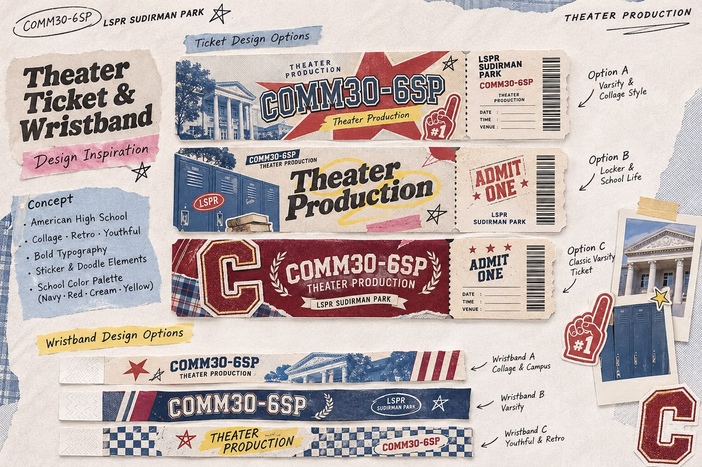
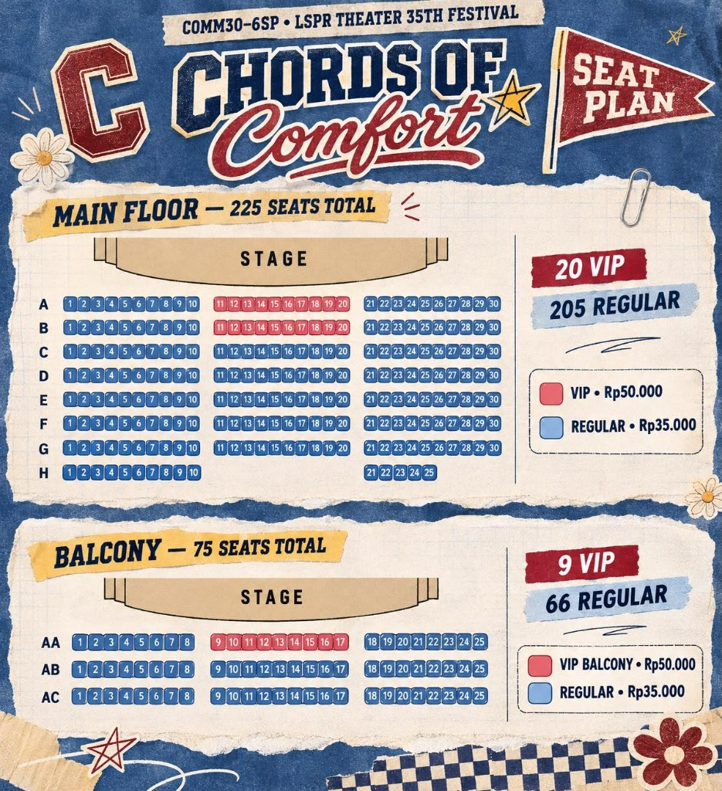

# 🎭 Chords of Comfort — Official Ticketing System

> **LSPR COMM30-6SP Musical Theater Production**  
> *American High School Musical Theater Experience at Amani Palladium Theatre, LSPR Bekasi*  
> *Production of The 35th LSPR Theater Festival*



---

## 📌 About the Project

**Chords of Comfort** is a full-stack digital ticketing platform built for the musical theater production by **LSPR Institute of Communication & Business** students from class **COMM30-6SP** as part of **The 35th LSPR Theater Festival**.

The application is a **production-ready ticketing and audience check-in system** covering the entire lifecycle: visual seat selection, real-time concurrency locking (anti-double booking), WhatsApp-based payment confirmation, official admit-one E-Ticket generation with encrypted QR Codes, an administrative control dashboard (`/admin`), and a mobile camera-based gate scanner (`/scanner`) for show day admission.

---

## 🎟️ Event Details

* **Event Name:** CHORDS OF COMFORT
* **Tagline:** *"Where Love, Friendship, and Dreams Find Their Way Home."*
* **Production:** COMM30-6SP • The 35th LSPR Theater Festival
* **Venue:** Amani Palladium Theatre, LSPR Bekasi, Indonesia  
  *(Transpark Juanda, Jl. Ir. H. Juanda No. 220, Duren Jaya, East Bekasi, Bekasi City, West Java 17111)*
* **Date & Schedule:** January 2027 • Date & Showtime TBA
* **Total Venue Capacity:** 300 Seats (225 Main Floor + 75 Balcony)
* **Official Hotline (WhatsApp):** `0819-1534-8866` ([wa.me/6281915348866](https://wa.me/6281915348866))
* **Official Instagram:** `@chordsofcomfort.theater` ([instagram.com/chordsofcomfort.theater](https://www.instagram.com/chordsofcomfort.theater?jplx=MXM3c3J3bGQ1NXJ5Zg==))

---

## 🖼️ Visual Aesthetic & Design System

The visual identity embodies an **American High School Musical & Varsity Scrapbook** aesthetic (inspired by vintage yearbooks, letterman jackets, and retro admit-one event stubs):

* **Varsity Navy:** `#182B49`
* **Crimson Red:** `#C1272D`
* **Varsity Gold / Yellow:** `#F4B32A`
* **Paper Cream / Ivory:** `#F8F5EE` / `#FAF6ED`
* **Typography:** `Bebas Neue` (Display & Titles) and `Plus Jakarta Sans` (Body & Interface)

### 300-Seat Venue Seating Plan
* **Main Floor (225 Seats Total)**:
  * 20 VIP Main Floor (Rows A & B, Seats 11–20) • Rp 50,000
  * 205 Regular Theater Pass (Rows A–H) • Rp 35,000
* **Balcony (75 Seats Total)**:
  * 9 VIP Balcony (Row AA, Seats 9–17) • Rp 50,000
  * 66 Regular Theater Pass (Rows AA–AC) • Rp 35,000



---

## 💻 Tech Stack & Architecture

| Layer | Technology | Purpose |
| :--- | :--- | :--- |
| **Language** | **TypeScript** | Strict type safety for ticket calculations, seat inventory, and order schemas |
| **Framework** | **Next.js 16 (App Router)** | Full-stack React framework with Server Components and Turbopack |
| **UI Library** | **React 19** | Modern interactive components for seat selection, modals, and scanner |
| **Styling** | **Tailwind CSS v4** | Utility-first styling with retro scrapbook & varsity aesthetics |
| **Database Store** | **Serverless JSON Store (`/tmp` persistence)** | Concurrency-safe local and Vercel serverless database engine |
| **QR Engine** | **`qrcode`** | High-resolution scannable QR Code generation with order payload |
| **Gate Scanner** | **`html5-qrcode`** | Zero-install web camera scanner for gatekeeper smartphones |
| **Icons & FX** | **Lucide React & Canvas-Confetti** | Modern icons and festive celebration effects |

---

## 🚀 Key Features

### 1. Interactive Seating Plan & Concurrency Locking
* Real-time seat statuses: **Available**, **Selected**, **Held**, and **Sold**.
* **10-minute hold window**: When an attendee selects seats and begins checkout, seats are temporarily locked to prevent duplicate purchases.
* Responsive viewport with zoom controls and horizontal scroll support for mobile devices.

### 2. WhatsApp Checkout & Transfer Workflow
* Direct committee payment channels: BCA (`7650892101` a.n. Viona), Mandiri (`1220019283741`), and E-Wallets (`081915348866`).
* **1-Click WhatsApp Confirmation**: Pre-fills an English message with Order ID, Attendee Name, Seat Numbers, and Total Bill sent directly to `0819-1534-8866`.
* Integrated interactive payment simulation modal for frictionless end-to-end testing.

### 3. Official E-Ticket Pass (`/ticket/[orderId]`)
* Vintage admit-one design featuring retro perforations, barcode, and high-resolution QR verification code.
* Displays attendee name, unique Order ID (e.g. `LSPR-6SP-XXXXXX`), seating category, and venue instructions.
* Print & PDF export mode with print-optimized stylesheets (`window.print()`).

### 4. Admin Management Dashboard (`/admin`)
* **Authorized Committee Accounts:**
  * Viona: `meovivi@vinsky.com` / `viona1002`
  * Alvin: `vinsky@vinsky.com` / `alvin123`
* **Comprehensive CRUD Controls:**
  * **Create:** Manual issuance of tickets for VIP Guests, Faculty, Sponsors, and on-site cash purchases.
  * **Read:** Live order table, search/filter engine, real-time KPI metrics, and seat occupancy inspector.
  * **Update:** Edit attendee contact information, approve payments (`Approve Payment`), and toggle gate check-in.
  * **Delete:** Cancel unpaid reservations, automatically releasing seats back to available inventory.
* **WhatsApp Templates Hub:** 4 standardized communication templates for instant 1-click dispatch.
* **CSV Export:** One-click download of all transaction and attendance records for offline backup.

### 5. Mobile Gate QR Scanner (`/scanner`)
* Fast in-browser camera scanner with visual and audio feedback (Success, Already Checked In, Invalid).
* Manual Order ID / Ticket Code lookup fallback for damaged or unscannable screens.
* Live 10-item recent check-in history.

---

## 🛠️ Getting Started

```bash
# Clone the repository
git clone https://github.com/ahmadalvin92/chords-of-comfort-ticketing.git

# Navigate to project directory
cd chords-of-comfort-ticketing

# Install dependencies
npm install

# Run development server
npm run dev
```

Open [http://localhost:3000](http://localhost:3000) to view the application.

---

## 📄 License & Credits

Organized by **COMM30-6SP • The 35th LSPR Theater Festival**  
LSPR Institute of Communication & Business, 2026–2027. All rights reserved.
