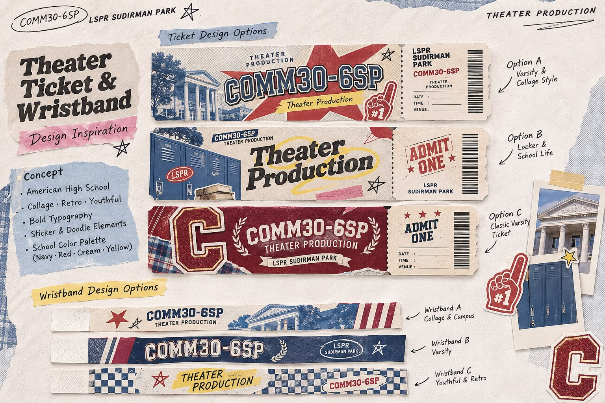
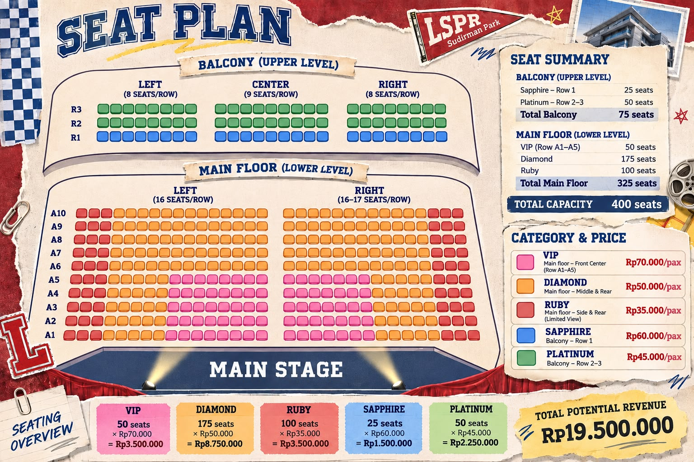

# 🎭 Chords of Comfort — Official Ticketing System

> **LSPR COMM30-6SP Musical Theater Production**  
> *American High School Musical Theater Experience at Auditorium LSPR Sudirman Park*



---

## 📌 Tentang Project

**Chords of Comfort** adalah platform sistem penjualan tiket pementasan teater musikal karya mahasiswa **LSPR Institute of Communication & Business** angkatan **COMM30-6SP**. 

Sistem ini dirancang bukan sekadar tampilan mockup, melainkan **aplikasi web reservasi tiket daring *full-stack* fungsional** yang menangani alur menyeluruh mulai dari pemilihan nomor kursi visual, penguncian kursi real-time (*anti double-booking*), integrasi gerbang pembayaran online (QRIS & Virtual Account), pengiriman E-Ticket instan via email, dashboard pelaporan panitia, hingga pemindai QR Code kamera HP untuk check-in penonton di hari-H pementasan.

---

## 🖼️ Tampilan Visual & Desain Sistem

Konsep antarmuka mengusung tema **American High School / Varsity Scrapbook Collage** (terinspirasi dari gaya *Golf le Fleur* & tiket retro *Admit-One*) dengan identitas warna resmi **Varsity Navy (`#182B49`)**, **Crimson Red (`#C1272D`)**, **Varsity Yellow (`#F4B32A`)**, dan **Paper Cream (`#F8F5EE`)**.

### 1. Interactive 400-Seat Seating Plan (Denah Kursi)
Denah kursi interaktif memetakan kapasitas total 400 kursi di venue Auditorium LSPR Sudirman Park secara presisi:
- **Balcony (Upper Level - 75 Kursi)**: Sapphire (Row R1) & Platinum (Row R2–R3).
- **Main Floor (Lower Level - 325 Kursi)**: VIP Front Center (Row A1–A5), Diamond Middle & Rear, Ruby Side & Rear.



### 2. Inspirasi Tiket & Wristband Admit-One
Desain E-ticket digital mengadaptasi format fisik tiket konser vintage dengan kode batang, perforasi gerigi, dan QR Code verifikasi.


### 3. Cast & Produksi Teater
Dokumentasi profil pemeran (*cast*) bertema seragam retro sekolah.


---

## 💻 Bahasa Pemrograman & Tech Stack

Aplikasi ini dibangun menggunakan arsitektur modern berkecepatan tinggi:

| Lapisan / Komponen | Teknologi | Keterangan & Alasan Penggunaan |
| :--- | :--- | :--- |
| **Bahasa Pemrograman** | **TypeScript (JavaScript)** | Memberikan *type safety* ketat untuk mencegah bug pada kalkulasi harga tiket dan status kursi. |
| **Bahasa Database** | **SQL (PostgreSQL)** | Mendukung *ACID Transactions* dan fungsi *Row-Level Lock* (`SELECT FOR UPDATE`) untuk memastikan tidak terjadi *race condition* atau *double-booking*. |
| **Frontend Framework** | **Next.js 16 (App Router)** | Framework React full-stack dengan performa Server Components & Turbopack. |
| **UI Library** | **React 19** | Komponen interaktif responsif untuk denah kursi, modal form, dan scanner. |
| **Styling & CSS** | **Tailwind CSS v4** | Utility-first styling untuk merancang estetika scrapbook, varsity badge, dan texturing retro. |
| **Database & Realtime** | **Supabase / PostgreSQL** | Database transaksional cloud berkecepatan tinggi dengan auto-realtime sync. |
| **Payment Gateway** | **Midtrans (Snap API)** | Pemrosesan pembayaran otomatis dengan webhook resmi: QRIS (GoPay, OVO, Dana, BCA) & Virtual Account. |
| **Email Service** | **Resend API** | Pengiriman otomatis email konfirmasi pemesanan dan E-ticket resmi ke inbox customer. |
| **QR Code Engine** | **`qrcode`** | Generator kode QR beresolusi tinggi dengan enkripsi payload verifikasi. |
| **Gate Check-In Scanner** | **`html5-qrcode`** | Pemindai kode QR berbasis kamera browser HP (tanpa perlu install aplikasi dari App Store/Play Store). |
| **Icons & FX** | **Lucide React & Canvas-Confetti** | Set ikon modern dan efek selebrasi saat transaksi sukses. |

---

## 🚀 Fitur Unggulan

### 1. Seating Plan Interaktif & Anti Double-Booking
- Customer dapat melihat denah panggung dan memilih nomor kursi secara visual.
- Status kursi dinamis: **Available** (warna kategori), **Selected** (highlight putih-cyan), **Held** (kuning berkedip), dan **Sold** (abu-abu terkunci).
- **Seat Locking Timer**: Kursi yang diklik customer langsung dikunci sementara selama **10 menit**. Customer lain tidak dapat memilih kursi tersebut saat proses isi form & bayar berlangsung.
- Batasan jumlah tiket maksimal 6 kursi per transaksi.

### 2. Multi-Payment Gateway (QRIS & Virtual Account)
- Terintegrasi dengan **Midtrans Snap**.
- Dilengkapi **Payment Simulator (Sandbox)** bawaan sehingga panitia dapat menguji alur pembayaran sukses seketika tanpa harus transfer uang sungguhan saat fase demo.
- Webhook verifikasi signature SHA-512 otomatis mengubah status menjadi `PAID`.

### 3. Automatic E-Ticket Delivery
- Terbit otomatis setelah pembayaran terverifikasi.
- Dilengkapi **Print-Friendly PDF Mode** (`window.print()`).
- Memuat nama pemegang tiket, Order ID unik (e.g. `LSPR-6SP-XXXXXX`), tanggal pementasan, nomor kursi, dan QR Code validasi gate.

### 4. Admin Dashboard Panitia (`/admin`)
- Pantauan pendapatan kumulatif real-time (target kapasitas penuh: Rp 19.500.000).
- Statistik keterisian kursi per kategori (VIP, Sapphire, Diamond, Platinum, Ruby).
- Tabel transaksi komprehensif dengan filter status (`PAID`, `PENDING`) dan pencarian instan berdasarkan Nama / No HP / Order ID / Nomor Kursi.
- **Export to CSV (Excel)** dengan satu klik untuk backup dan arsip helpdesk fisik.
- Tombol **Reset Data** untuk membersihkan data uji coba sebelum penjualan resmi dibuka.

### 5. Mobile QR Gate Scanner (`/scanner`)
- Cukup dibuka melalui browser ponsel panitia di pintu masuk venue LSPR Sudirman Park.
- Validasi instan:
  - 🟢 **VALID**: Tiket sah, menampilkan detail nama dan nomor kursi disertai nada beep tinggi.
  - 🟡 **ALREADY CHECKED IN**: Tiket sudah pernah dipindai sebelumnya (mencegah tiket digandakan atau di-share).
  - 🔴 **INVALID**: Tiket tidak ditemukan atau belum lunas.
- Dilengkapi kolom **Input Manual Order ID** jika kamera menghadapi pencahayaan minim.

---

## 📂 Struktur Direktori

```plaintext
chords-of-comfort-ticketing/
├── public/
│   └── assets/                  # Foto cast, denah kursi, dan aset retro
├── src/
│   ├── app/
│   │   ├── admin/               # Halaman Dashboard Admin Panitia
│   │   ├── api/
│   │   │   ├── admin/           # Endpoint API manajemen & reset
│   │   │   ├── checkin/         # Endpoint validasi QR gate scanner
│   │   │   ├── checkout/        # Endpoint pembuatan order & Snap token
│   │   │   ├── payment/         # Endpoint konfirmasi & webhook Midtrans
│   │   │   ├── seats/           # Endpoint status kursi & atomic lock
│   │   │   └── ticket/          # Endpoint detail e-ticket per Order ID
│   │   ├── scanner/             # Halaman Mobile Camera QR Gate Scanner
│   │   ├── ticket/[orderId]/    # Halaman E-Ticket Resmi Admit-One
│   │   ├── globals.css          # Styling Tailwind & efek scrapbook tape
│   │   ├── layout.tsx           # Layout dasar & Google Fonts (Bebas Neue)
│   │   └── page.tsx             # Halaman Beranda Pembelian Tiket
│   ├── components/              # Komponen UI (Navbar, Hero, SeatPlan, dll)
│   ├── data/                    # Data inisialisasi 400 kursi venue
│   ├── lib/                     # Data store persistent & integrasi Resend
│   └── types/                   # Definisi TypeScript
├── supabase/
│   └── schema.sql               # Skema PostgreSQL & atomic locking trigger
├── PANDUAN_PENGGUNAAN.md        # SOP operasional panitia ticketing & gate
├── .env.example                 # Template Environment Variables
└── package.json
```

---

## 🛠️ Cara Menjalankan Project di Lokal

### 1. Clone Repository
```bash
git clone https://github.com/ahmadalvin92/chords-of-comfort-ticketing.git
cd chords-of-comfort-ticketing
```

### 2. Install Dependensi
```bash
npm install
```

### 3. Konfigurasi Environment Variables (Opsional)
Salin `.env.example` menjadi `.env.local`:
```bash
cp .env.example .env.local
```
*(Catatan: Tanpa mengisi API Key Midtrans atau Resend pun, sistem sudah otomatis berjalan dalam **Simulator Mode** sehingga seluruh fitur tetap 100% dapat dicoba secara offline).*

### 4. Jalankan Server Development
```bash
npm run dev
```
Buka browser di **[http://localhost:3000](http://localhost:3000)**.

---

## 🌐 Deploy ke Production (Vercel)

1. Hubungkan repository GitHub ini ke akun [Vercel](https://vercel.com).
2. Tambahkan Environment Variable sesuai kebutuhan (`MIDTRANS_SERVER_KEY`, `RESEND_API_KEY`).
3. Klik **Deploy** — website akan langsung aktif online dengan SSL gratis.

---

## 👥 Tim Produksi & Kredit

- **Penyelenggara**: LSPR Institute of Communication & Business — COMM30-6SP
- **Judul Pementasan**: Chords of Comfort: The Musical
- **Venue**: Auditorium LSPR Sudirman Park, Lantai 2, Jakarta Pusat
- **Kapasitas**: 400 Kursi (Reserved Seating)

*© 2026 LSPR COMM30-6SP Musical Theater Production. All rights reserved.*
